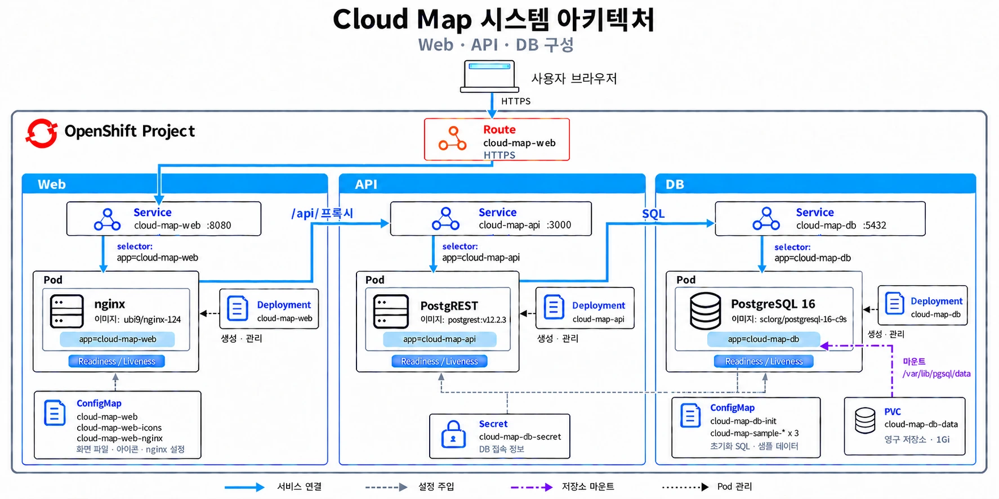
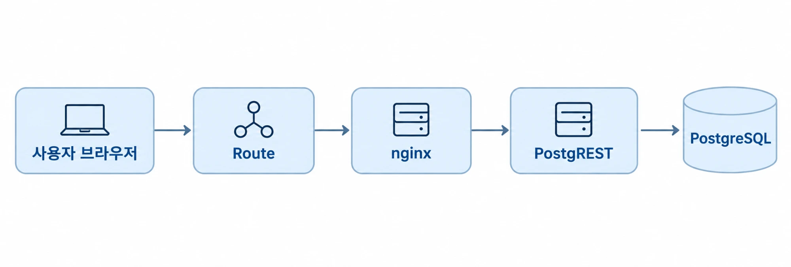
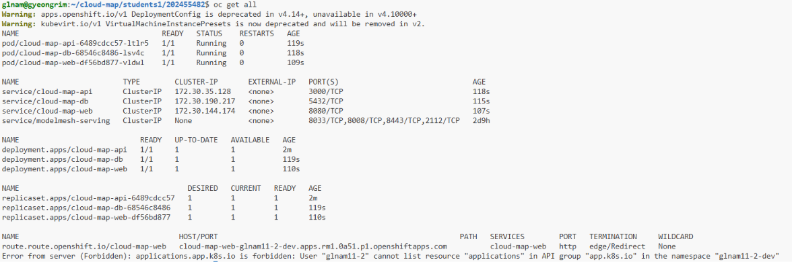
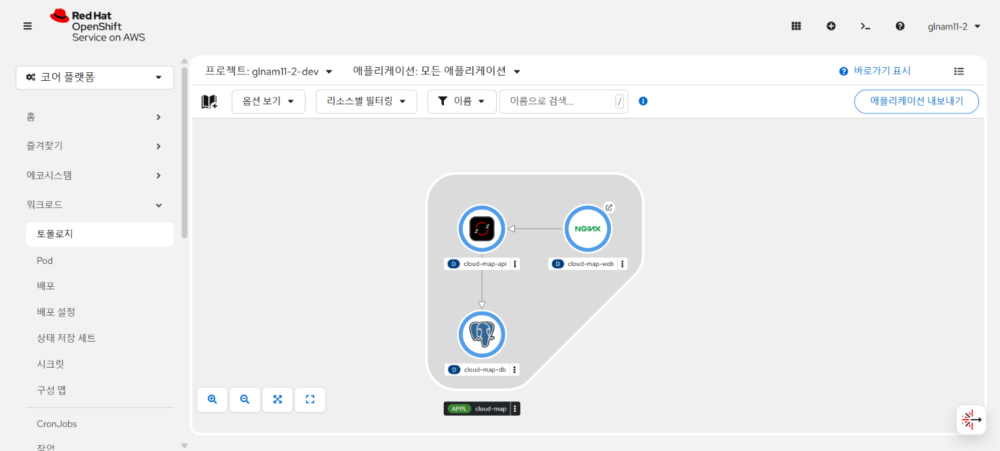
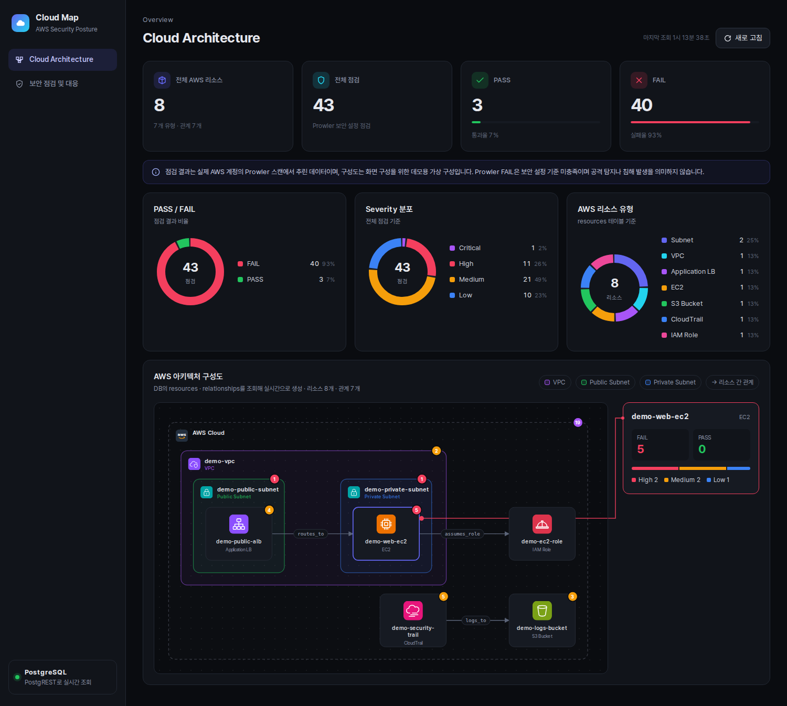
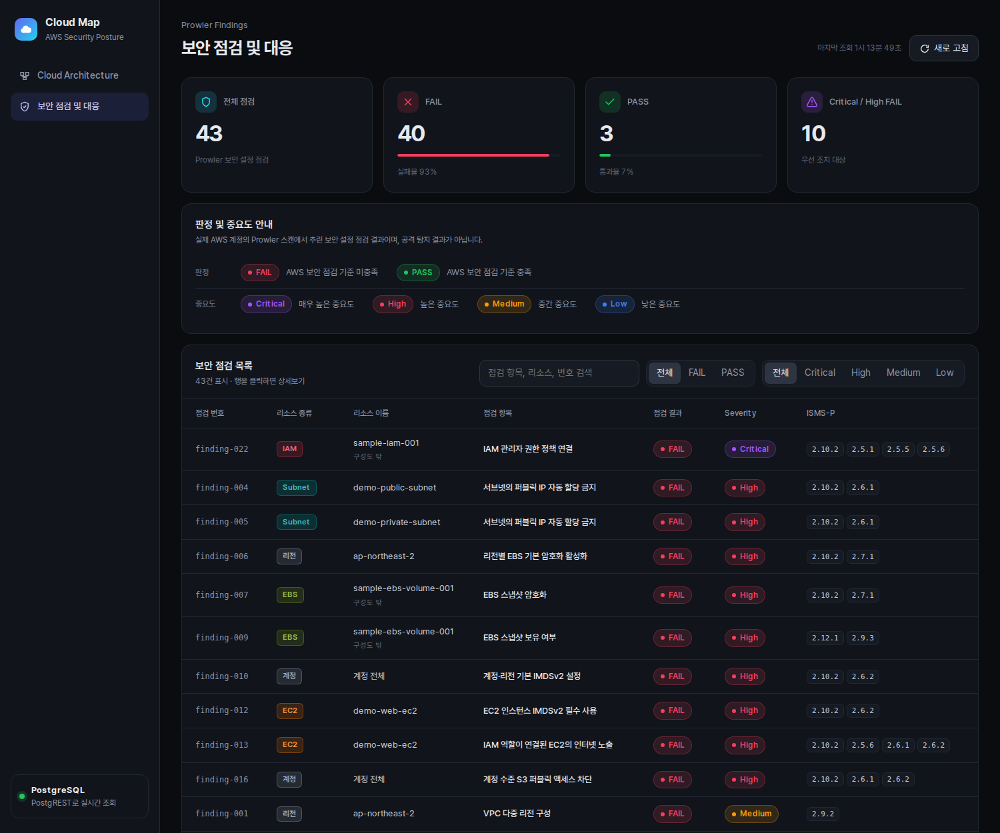
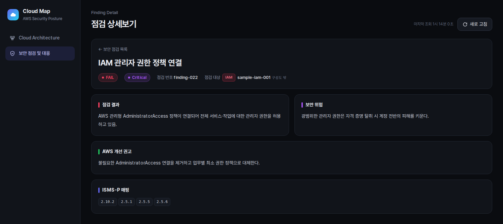

# Cloud Map: DB 기반 AWS 구성도·보안 점검 웹 서비스

## 1. 컨테이너 소개

| 항목 | 내용 |
|---|---|
| **서비스 이름** | Cloud Map |
| **한 줄 설명** | Prowler로 스캔을 마친 결과 JSON을 PostgreSQL에 적재하고, 이 데이터로 AWS 구성도와 보안 점검 항목을 화면에 표시하는 3-tier 웹앱 |
| **주제 선택 이유** | 문제<br>- AWS를 쓰지만 보안 전문가가 아닌 사용자는 Prowler 스캔 결과(JSON)만으로 어느 리소스에 어떤 문제가 있는지 파악하기 어려움<br>해결 방향<br>- AWS 구성도: DB의 리소스 관계로 구성도를 생성하고, 리소스별 점검 결과를 함께 표시해 문제 위치를 시각화<br>- 보안 점검 페이지: 점검 항목마다 무엇이 문제인지(점검 결과), 왜 위험한지(보안 위험), 어떻게 해결하는지(AWS 개선 권고), 어떤 정책 기준과 관련되는지(ISMS-P 매핑)를 한 화면에서 파악 |
| **향후 확장** | Prowler 점검 실행<br>- 웹 화면에서 AWS 계정을 연결하고 원하는 시점에 Prowler 점검 실행<br>- 점검 결과를 DB에 바로 적재해 구성도와 점검 목록에 반영<br>ISMS-P 매핑<br>- ISMS-P 인증 기준 항목(번호·항목명·세부 내용)을 DB에 적재<br>- 점검 결과의 ISMS-P 번호와 연결해 화면에 항목 내용까지 표시 |

### 1-1. 주요 기능

**Cloud Architecture 화면**
1. 리소스·점검 수 통계와 PASS/FAIL·Severity·리소스 유형 차트
2. AWS 구성도: VPC·Subnet 박스 안에 리소스를 배치하고, 리소스 간 관계를 화살표로 표시. DB 내용이 바뀌면 새로 고침 시 반영
3. 리소스별 보안 현황: 노드마다 FAIL 건수 배지 표시. 리소스에 마우스를 올리면 오른쪽 패널에 FAIL·PASS 건수와 중요도 분포 표시, 클릭 시 고정

**보안 점검 및 대응 화면**
1. Prowler 점검 43건을 점검 번호, 리소스 종류, 리소스 이름, 점검 항목, 결과, Severity, ISMS-P로 정리한 목록
2. FAIL 우선·중요도 순 정렬. 검색, 결과·Severity 필터, 열 정렬

**점검 상세보기**
1. 점검 결과, 보안 위험, AWS 개선 권고, ISMS-P 매핑을 한 화면에 표시
2. 한국어 번역 우선, 번역이 없으면 영문 원문 표시

점검 데이터는 실제 AWS 계정을 Prowler로 스캔한 결과에서 43건을 추리고, 계정 정보 등 식별 정보를 제거한 것입니다. AWS 구성도의 리소스 8개·관계 7개와 점검 결과-리소스 연결은 화면 구성을 보여 주기 위한 데모용 가상 데이터입니다.

## 2. 아키텍처 & ERD

### 2-1. 아키텍처



실선은 요청이 오가는 서비스 연결입니다. 점선은 ConfigMap·Secret 주입, 보라색 점선은 PVC 마운트, 점 화살표는 Deployment의 Pod 생성·관리를 나타냅니다. Service는 `selector` 라벨로 Pod를 찾습니다.

### 2-2. 요청 흐름 (Flow chart)



```text
    Browser                nginx (web)            PostgREST (api)          PostgreSQL (db)
       |                        |                        |                        |
       | (1) GET page files     |                        |                        |
       |----------------------->|                        |                        |
       | html/js/css/icons      |                        |                        |
       |<-----------------------|                        |                        |
       |                        |                        |                        |
       | (2) ELK.js from CDN    |                        |                        |
       |     (jsDelivr)         |                        |                        |
       |                        |                        |                        |
       | (3) GET /api/relations |                        |                        |
       |----------------------->|                        |                        |
       |                        | (4) proxy_pass         |                        |
       |                        |----------------------->|                        |
       |                        |                        | (5) SELECT view        |
       |                        |                        |----------------------->|
       |                        |                        | rows                   |
       |                        |                        |<-----------------------|
       |                        | JSON                   |                        |
       |                        |<-----------------------|                        |
       | JSON                   |                        |                        |
       |<-----------------------|                        |                        |
       |                        |                        |                        |
       | (6) layout + SVG       |                        |                        |
       |                        |                        |                        |
```

| 번호 | 설명 |
|---|---|
| (1) | 브라우저의 화면 파일(`index.html`, `app.js`, `style.css`, `icon-*.svg`) 요청. nginx가 ConfigMap에서 마운트된 파일로 응답 |
| (2) | 구성도 배치 라이브러리 ELK.js를 jsDelivr CDN(클러스터 밖)에서 브라우저가 직접 다운로드 |
| (3) | `app.js`의 `/api/resources`, `/api/relationships`, `/api/findings` 요청. `findings`의 `resource_id`로 점검 결과를 구성도 노드에 연결 |
| (4) | nginx의 `/api/` 요청 전달(`proxy_pass`). nginx는 데이터를 보관하지 않음 |
| (5) | PostgREST의 `api` 스키마 View 조회. 결과 행을 JSON으로 변환해 nginx를 거쳐 브라우저로 응답 |
| (6) | 브라우저의 `app.js`가 JSON과 ELK.js로 좌표를 계산한 뒤 통계·차트·표와 SVG 구성도 생성 |

구성도 생성은 배포 시점이 아니라 페이지 요청 시점에 브라우저에서 실행됩니다. 따라서 배포 YAML에는 렌더링 코드나 별도 Job이 없습니다.

### 2-3. DB 구조 (ERD)

```text
+--------------------------+          +------------------------------+
| resources                |          | relationships                |
+--------------------------+          +------------------------------+
| PK resource_id           |<---------| FK source_id                 |
|    resource_type         |<---------| FK target_id                 |
|    resource_name         |    1 : N |    relation_type             |
|    region                |          | PK (source_id, target_id,    |
|    is_synthetic          |          |     relation_type)           |
+--------------------------+          +------------------------------+
            ^
            : resource_id (no FK, NULL for account/region scope)
            :
+--------------------------+          +------------------------------+
| findings                 |          | finding_details              |
+--------------------------+          +------------------------------+
| PK finding_id            |<---------| PK,FK finding_id             |
|    resource_id           |    1 : 1 |    status_detail(_ko)        |
|    scope_type            |          |    risk_details(_ko)         |
|    check_id, check_title |          |    remediation(_ko)          |
|    check_title_ko        |          |    compliance (JSONB)        |
|    status, severity      |          |    raw_data   (JSONB)        |
+--------------------------+          +------------------------------+
```

#### 테이블 역할과 관계

- `resources`
  - AWS 리소스 목록 8개(VPC, Subnet, ALB, EC2 등)
  - 구성도의 노드와 VPC·Subnet 박스로 사용
- `relationships`
  - 리소스 사이의 관계 7개
  - 구성도에서 박스 포함(`contains`·`hosts`)과 화살표(나머지 관계)로 사용
- `findings`
  - Prowler 점검 결과 43건. 대상 리소스와 연결(계정·리전 단위 점검은 연결 없음)
  - 통계·차트, 보안 점검 목록, 구성도의 리소스별 보안 현황에 사용
- `finding_details`
  - 점검별 상세 설명(점검 결과, 보안 위험, 개선 권고, ISMS-P 매핑)과 한국어 번역
  - 점검 상세보기 화면에 사용

#### 초기화와 접근 권한

- PostgreSQL 이미지(sclorg)는 서버를 기동할 때마다 `/opt/app-root/src/postgresql-start/*.sh`를 실행합니다. 이 경로에 ConfigMap을 마운트했습니다.
- `resources` 테이블이 비어 있을 때만 샘플을 적재합니다. PVC에 데이터가 있으면 기존 데이터를 유지합니다.
- PostgREST는 `web_anon` 역할로 요청을 처리합니다. `web_anon`은 `api` 스키마 View 4개(`resources`, `relationships`, `findings`, `finding_details`)의 SELECT 권한만 보유합니다. 원본 테이블 조회와 쓰기는 불가능합니다.

## 3. 사용한 Object

### 3-1. Object 목록

<table>
  <tr><th>Object</th><th>이름</th><th>역할</th></tr>
  <tr><td rowspan="3"><b>Deployment</b></td><td><code>cloud-map-db</code></td><td>PostgreSQL 16 실행. PVC 단독 사용을 위해 <code>Recreate</code> 전략 사용</td></tr>
  <tr><td><code>cloud-map-api</code></td><td>PostgREST 실행. <code>api</code> 스키마를 읽기 전용 REST API로 공개</td></tr>
  <tr><td><code>cloud-map-web</code></td><td>nginx 실행. 화면 파일 제공, <code>/api/</code> 요청 프록시</td></tr>
  <tr><td><b>Service</b></td><td><code>cloud-map-db</code><br><code>cloud-map-api</code><br><code>cloud-map-web</code></td><td>Pod 고정 접속 주소. DB·API는 클러스터 내부 전용</td></tr>
  <tr><td><b>Route</b></td><td><code>cloud-map-web</code></td><td>외부 HTTPS 주소. edge TLS, HTTP 요청은 HTTPS로 리다이렉트. host는 OpenShift가 자동 생성</td></tr>
  <tr><td><b>Secret</b></td><td><code>cloud-map-db-secret</code></td><td>DB 계정·비밀번호·DB 이름. PostgreSQL은 계정 생성에, PostgREST는 접속에 사용</td></tr>
  <tr><td><b>PersistentVolumeClaim</b></td><td><code>cloud-map-db-data</code></td><td>DB 데이터 1Gi. Pod 재생성 후에도 데이터 유지</td></tr>
  <tr><td rowspan="7"><b>ConfigMap</b></td><td><code>cloud-map-db-init</code></td><td>PostgreSQL start 훅(<code>10-cloud-map.sh</code>)과 <code>init.sql</code>. 테이블 생성, 샘플 적재, API View·권한 생성</td></tr>
  <tr><td><code>cloud-map-sample-architecture</code></td><td>최초 적재용 데모 구성 JSON(리소스 8개, 관계 7개)</td></tr>
  <tr><td><code>cloud-map-sample-findings-en</code></td><td>최초 적재용 Prowler 점검 원문 JSON(영문, 43건)</td></tr>
  <tr><td><code>cloud-map-sample-findings-ko</code></td><td>최초 적재용 점검 한국어 번역 JSON(43건)</td></tr>
  <tr><td><code>cloud-map-web</code></td><td>웹 화면 파일(<code>index.html</code>, <code>style.css</code>, <code>app.js</code>)</td></tr>
  <tr><td><code>cloud-map-web-icons</code></td><td>구성도 아이콘 SVG 8개</td></tr>
  <tr><td><code>cloud-map-web-nginx</code></td><td><code>/api/</code> → <code>cloud-map-api:3000</code> 프록시 설정</td></tr>
  <tr><td><b>projected 볼륨</b></td><td>DB·웹 Deployment</td><td>여러 ConfigMap을 한 폴더에 합쳐 마운트. 샘플 3개 → DB <code>/cloud-map-data</code>, 화면·아이콘 → nginx 문서 루트</td></tr>
  <tr><td><b>Probe</b></td><td>3개 Deployment 전체</td><td>Readiness 실패 시 Service 트래픽 제외, Liveness 실패 시 컨테이너 재시작</td></tr>
  <tr><td><b>resources</b></td><td>3개 Deployment 전체</td><td>Sandbox 할당량 안에서 requests/limits 지정</td></tr>
</table>

### 3-2. Probe·resources 설정

| 컨테이너 | Readiness | Liveness | CPU request/limit | 메모리 request/limit |
|---|---|---|---|---|
| postgresql | `check-container`(`pg_isready`) | `check-container --live` | 100m / 500m | 128Mi / 512Mi |
| postgrest | `GET :3001/ready` | `GET :3001/live` | 50m / 250m | 64Mi / 128Mi |
| nginx | `GET :8080/` | `GET :8080/` | 50m / 200m | 32Mi / 128Mi |

### 3-3. YAML 파일 설명

| 파일 | 역할 | 주요 설정 |
|---|---|---|
| `secret.yaml` | DB 계정·비밀번호·DB 이름 저장. DB와 API가 함께 사용 | `stringData`: 평문으로 작성하면 저장 시 base64로 변환(실습용 값) |
| `route.yaml` | 외부 HTTPS 주소 생성 | `host` 없음: 프로젝트에 맞는 주소 자동 생성<br>`tls.termination: edge`: Router에서 HTTPS 처리 |
| `db-deployment.yaml` | PostgreSQL Pod 실행 | `strategy: Recreate`: 기존 Pod를 내린 뒤 새 Pod 생성<br>`envFrom.secretRef`: Secret 값으로 계정·DB 생성<br>훅 폴더에 초기화 스크립트, `/cloud-map-data`에 샘플 JSON 마운트 |
| `db-service.yaml` | 클러스터 내부 DB 주소 | `cloud-map-db:5432` |
| `db-pvc.yaml` | DB 데이터 저장소 | `ReadWriteOnce`, `1Gi` |
| `db-init-configmap.yaml` | DB 초기화 스크립트 | `10-cloud-map.sh`, `init.sql`: 테이블·API View·권한 생성, 비어 있으면 샘플 적재 |
| `sample-*-configmap.yaml` (3개) | 최초 적재용 샘플 데이터 | 구성(`architecture`), Prowler 원문(`findings-en`), 한국어 번역(`findings-ko`) |
| `api-deployment.yaml` | PostgREST Pod 실행 | `PGRST_DB_URI`: `$(PGDATABASE)`로 Secret 값 참조<br>`PGRST_DB_SCHEMAS: api`, `PGRST_DB_ANON_ROLE: web_anon`: View만 읽기 전용 공개<br>3001 포트 `/ready`·`/live`로 Probe 확인 |
| `api-service.yaml` | 클러스터 내부 API 주소 | `cloud-map-api:3000` |
| `web-deployment.yaml` | nginx Pod 실행 | `command`: 이미지 기본 명령 대신 nginx 실행<br>화면 파일·아이콘을 문서 루트에, 프록시 설정을 `nginx.default.d`에 읽기 전용 마운트 |
| `web-service.yaml` | 웹 Pod 주소. Route가 연결 | `cloud-map-web:8080` |
| `web-configmap.yaml` | 화면 파일 | `index.html`, `style.css`, `app.js` |
| `web-icons-configmap.yaml` | 구성도 아이콘 | SVG 8개 |
| `web-nginx-configmap.yaml` | nginx 프록시 설정 | `/api/` → `cloud-map-api:3000` |

## 4. 사용 이미지

**PostgreSQL** · `quay.io/sclorg/postgresql-16-c9s:20261021` · 포트 5432
- 비루트 실행 지원: OpenShift가 임의 UID로 실행해도 데이터 폴더 권한 오류 없이 동작
- 자동 초기화: 환경변수(`POSTGRESQL_USER` 등)만으로 계정과 DB 생성, start 훅 폴더로 초기화 SQL 실행
- 다운로드 제한 없음: Docker Hub가 아닌 quay.io 이미지

**PostgREST** · `docker.io/postgrest/postgrest:v12.2.3` · 포트 3000(API), 3001(상태 확인)
- 코드 없는 API: DB 스키마를 설정만으로 읽기 전용 REST API로 공개
- 가벼움: 단일 실행 파일이라 메모리 사용량이 작고 비루트로 실행
- Docker Hub 이미지라서 Sandbox에서 다운로드 가능 여부를 먼저 확인한 뒤 사용

**nginx** · `registry.access.redhat.com/ubi9/nginx-124:1-1793106205` · 포트 8080
- 비루트 실행 지원: Red Hat UBI 기반이라 OpenShift 임의 UID 환경에서 그대로 동작
- 1024 이상 포트: 8080을 사용해 비루트의 80 포트 바인딩 오류(`bind: permission denied`)가 없음
- 설정 확장 경로: `nginx.default.d` 폴더에 `/api/` 프록시 설정만 추가하면 됨

## 5. 배포 방법

```bash
oc apply -f k8s/
oc rollout status deployment/cloud-map-db
oc rollout status deployment/cloud-map-api
oc rollout status deployment/cloud-map-web
oc get route cloud-map-web
```

### 5-1. 확인 방법

| 접속 경로 | 예상 결과 |
|---|---|
| `https://<route-host>/` | Cloud Architecture 화면. 리소스 8, 점검 43, PASS 3, FAIL 40, VPC·Subnet 박스와 AWS 아이콘이 있는 구성도 |
| `https://<route-host>/#security` | 보안 점검 및 대응 화면. 첫 행 `finding-022`(FAIL, Critical) |
| `https://<route-host>/#finding/finding-022` | 점검 상세보기. 점검 결과·보안 위험·AWS 개선 권고·ISMS-P 매핑 |
| `https://<route-host>/api/resources` | 리소스 8건 JSON |

```bash
H=$(oc get route cloud-map-web -o jsonpath='{.spec.host}')
curl -s https://$H/api/resources
```

### 5-2. 원본 수정 시 ConfigMap 재생성

화면·SQL·샘플 원본은 `web/`, `db/`, `data/`에 있습니다. `k8s/`의 ConfigMap 7개는 다음 명령으로 생성한 결과물입니다. 원본을 수정한 경우에만 실행하십시오.

```bash
sh tools/build-configmaps.sh
oc apply -f k8s/
oc rollout restart deployment/cloud-map-web
```

### 5-3. 삭제

```bash
oc delete -f k8s/
```

## 6. 배포 결과

Developer Sandbox(`glnam11-2-dev`)에서 `oc delete -f k8s/` 후 `oc apply -f k8s/`로 재배포하여 3개 Pod Running, Route 응답 200, 점검 데이터 43건을 확인했습니다.

### 6-1. `oc get all` 결과



맨 위 `Warning` 2줄과 맨 아래 `Forbidden` 1줄은 `oc get all`이 클러스터의 모든 리소스 종류를 조회할 때 출력되는 Sandbox 공통 메시지입니다. `service/modelmesh-serving`은 Sandbox가 기본으로 만든 리소스입니다.

### 6-2. Topology



### 6-3. Cloud Architecture 화면



### 6-4. 보안 점검 및 대응 화면



### 6-5. 점검 상세보기



## 7. 어려웠던 점

### 7-1. 용도가 다른 두 오픈소스 결합

**문제**
- 첫 목표: 오픈소스 두 개를 결합해 DB 기반 AWS 구성도 웹앱 구성
  - Grafana: 보안 점검 통계·표를 보여 주는 대시보드
  - TerraVision: AWS 아이콘과 VPC·Subnet 박스로 구성도를 그리는 도구
- Grafana Pod의 initContainer 2개에서 DB 조회와 TerraVision 렌더링을 실행하고, 생성한 SVG를 Grafana에 표시
- 결과
  - 배포 YAML 약 1만 줄, 실행 코드 6개 포함
  - 구성도 그림을 만드는 단계가 실패하면 Grafana 화면 전체가 뜨지 않음 (그림 생성에만 메모리 최대 1Gi 사용)
  - Secret 3개 수동 생성, Route host 고정 기록으로 `oc apply -f k8s/`만으로 재현 불가

**원인**
- 용도가 다른 두 도구를 직접 이어 하나의 웹앱으로 만들려고 한 구조
  - TerraVision은 Terraform 코드를 읽는 도구라 DB를 직접 읽지 못함 → DB 조회 결과를 Terraform 형식으로 바꾸는 변환 코드 필요
  - Grafana는 표·차트용 도구라 AWS 구성도를 직접 그리지 못함 → 생성한 SVG를 공유 볼륨으로 넘기는 전달 장치 필요
- 두 도구 사이를 메우는 변환·전달 코드가 모두 배포 단계에 들어가면서 구조가 무거워짐

**해결**
- 표준 방식(HTTP, SQL)으로 연결되는 nginx + PostgREST + PostgreSQL 구성으로 변경
- AWS 구성도 생성을 배포 단계에서 브라우저로 이동
- 배포 YAML에는 이미지·설정·Object 구성만 유지. Secret 포함, Route host 제거

**회고**
- 배포 YAML은 "무엇을 띄울지" 선언하는 곳이고, 계산·변환 코드를 실행하는 곳이 아님
- 도구를 고를 때 기능보다 다른 구성 요소와 연결되는 방식을 먼저 확인
- AWS 구성도가 페이지 요청마다 DB를 조회하므로 데이터 변경이 새로 고침만으로 반영됨

### 7-2. ConfigMap 크기 제한

`oc apply`는 `last-applied-configuration` 주석에 전체 내용을 저장하며, 주석 크기 제한은 256KiB입니다. Prowler 샘플 JSON은 234KB라서 번역 JSON과 합치면 제한을 초과합니다. 샘플을 구성·영문 원문·한국어 번역 ConfigMap 3개로 분리하고, DB Pod에서 projected 볼륨으로 한 폴더에 합쳐 마운트했습니다. 원본 JSON의 들여쓰기를 유지하므로 YAML에서도 내용을 확인할 수 있습니다.

### 7-3. Developer Sandbox 자동 축소와 로그인 만료

배포 후 시간이 지나자 Sandbox 운영 정책으로 Deployment가 `replicas: 0`으로 자동 축소되어 "Application is not available"이 표시되었고, `oc login` 토큰도 만료되어 `oc apply`가 `Unauthorized`로 실패했습니다. `oc scale --replicas=1`로 Pod를 복구하고, 웹 콘솔의 Copy login command로 다시 로그인해 해결했습니다. DB 데이터는 PVC에 남아 있어 유지되었습니다.

## 8. AI·참고자료 활용 내역

### 8-1. 역할 구분

| 작업 | 수행 |
|---|---|
| 주제 선정 (Prowler 결과 + AWS 구성도 시각화) | 본인 |
| 실제 AWS 계정 Prowler 스캔, 결과 43건 선별과 식별 정보 제거 | 본인 |
| 첫 버전 구상 (Grafana + TerraVision으로 AWS 구성도 웹앱) | 본인 |
| 첫 버전 문제 분석과 3-tier 구조(nginx + PostgREST + PostgreSQL) 설계 | Claude가 제안, 본인이 결정 |
| Deployment·Service·Route·ConfigMap·Secret·PVC YAML 작성 | Claude |
| DB 초기화 SQL, 웹 화면(HTML·CSS·JS), ConfigMap 생성 스크립트 작성 | Claude |
| 화면 디자인·기능 요구사항 (다크 대시보드, 리소스별 보안 현황 패널, 표 열 구성) | 본인이 요구하고 Claude가 구현 |
| 오류 원인 분석 (초기화 훅 순서, ConfigMap 크기 제한, Sandbox 자동 축소) | Claude가 분석, 본인이 확인 |
| 아키텍처 그림 | Codex |
| README 초안 작성 | Claude |
| README 구성·문구 수정 방향 결정 | 본인 |
| Developer Sandbox 배포와 재배포 확인 | 본인 |

### 8-2. AI 도구

| 도구 | 용도 |
|---|---|
| Claude Code (Claude Opus 5.5) | 기존 구조 문제 분석, 3-tier 구조 설계, YAML·SQL·웹 화면 코드 작성, 오류 분석, README 초안 작성 |
| Codex | 아키텍처 그림 작성 |

AI가 작성한 YAML은 본인 Developer Sandbox(`glnam11-2-dev`)에 직접 배포해 Pod Running과 Route 접속을 확인했고, `oc delete -f k8s/` 후 `oc apply -f k8s/`로 재배포해 다시 정상 동작하는 것까지 확인했습니다(6절). YAML 파일별 역할과 주요 설정은 3-3절에 정리했습니다.

### 8-3. 참고자료

1. 지능형 IoT 플랫폼 수업 & 강의자료
2. Kubernetes 문서 (Deployment, Service, ConfigMap, Secret, PVC, projected 볼륨, Probe). https://kubernetes.io/docs/concepts/
3. Red Hat OpenShift 문서 (Route, edge TLS). https://docs.redhat.com/en/documentation/openshift_container_platform/
4. sclorg/postgresql-container (환경변수, start 훅 폴더, `check-container` Probe). https://github.com/sclorg/postgresql-container
5. PostgREST 문서 v12 (스키마 공개, `PGRST_DB_ANON_ROLE`, `/live`·`/ready` 상태 확인). https://docs.postgrest.org/en/v12/
6. sclorg/nginx-container (UBI nginx 문서 루트, `nginx.default.d` 설정 경로). https://github.com/sclorg/nginx-container
7. ELK.js (layered 알고리즘, 계층 노드 `INCLUDE_CHILDREN` 배치). https://github.com/kieler/elkjs
8. AWS Architecture Icons (구성도 아이콘 카테고리 색상 참고, 아이콘은 SVG로 직접 작성). https://aws.amazon.com/architecture/icons/
9. Prowler (AWS 계정 보안 점검 실행, 결과 형식 OCSF). https://github.com/prowler-cloud/prowler

## 9. 파일 구조

```text
.
├── README.md
├── k8s/                          # 채점 대상: oc apply -f k8s/
│   ├── secret.yaml
│   ├── db-pvc.yaml
│   ├── db-deployment.yaml
│   ├── db-service.yaml
│   ├── db-init-configmap.yaml        # 생성물(db/)
│   ├── sample-architecture-configmap.yaml   # 생성물(data/)
│   ├── sample-findings-en-configmap.yaml    # 생성물(data/, 영문 원문)
│   ├── sample-findings-ko-configmap.yaml    # 생성물(data/, 한국어 번역)
│   ├── api-deployment.yaml
│   ├── api-service.yaml
│   ├── web-deployment.yaml
│   ├── web-service.yaml
│   ├── web-configmap.yaml            # 생성물(web/)
│   ├── web-icons-configmap.yaml      # 생성물(web/icons/)
│   ├── web-nginx-configmap.yaml      # 생성물(web/nginx-api.conf)
│   └── route.yaml
├── db/                           # DB 초기화 원본
│   ├── 10-cloud-map.sh
│   └── init.sql
├── data/                         # 샘플 JSON 원본
├── web/                          # 웹 화면 원본
│   ├── index.html
│   ├── style.css
│   ├── app.js
│   ├── nginx-api.conf
│   └── icons/                    # 구성도 아이콘 SVG
├── tools/
│   └── build-configmaps.sh       # 원본 → k8s/ ConfigMap 생성
└── images/                       # 배포 결과 캡처
```
